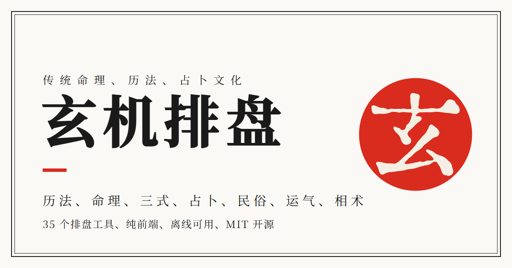
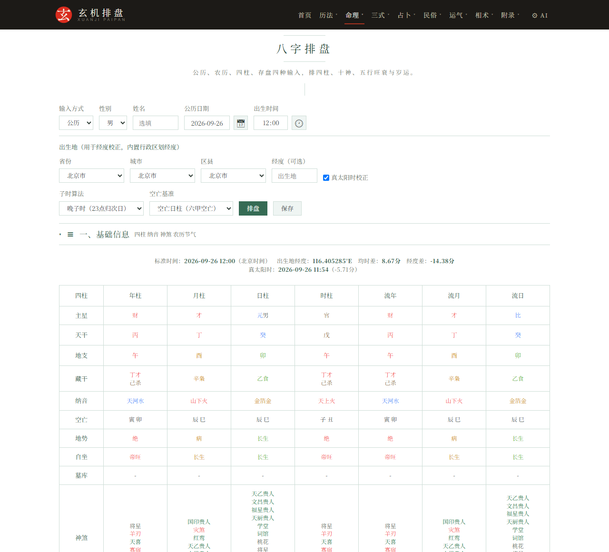
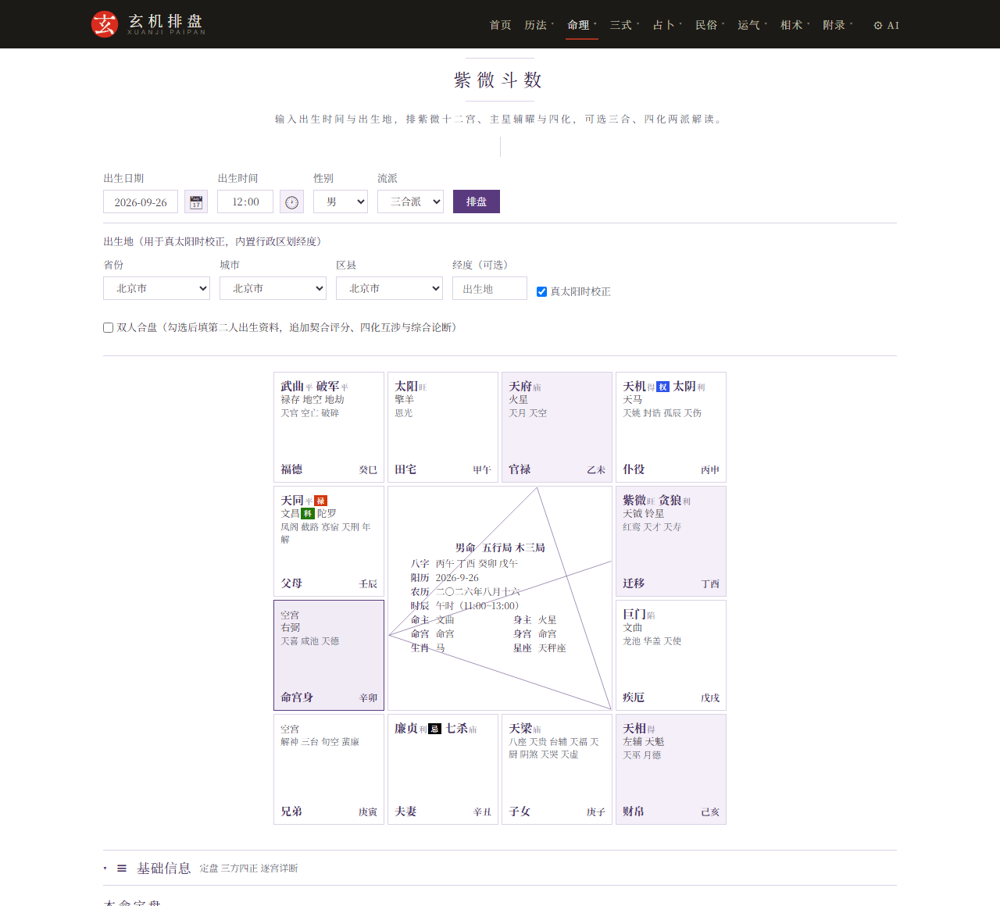
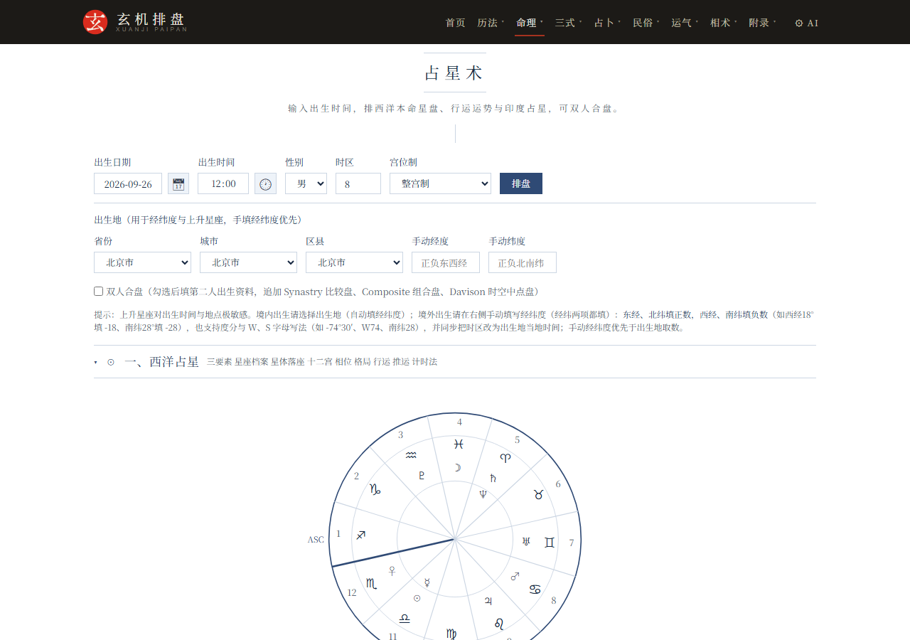
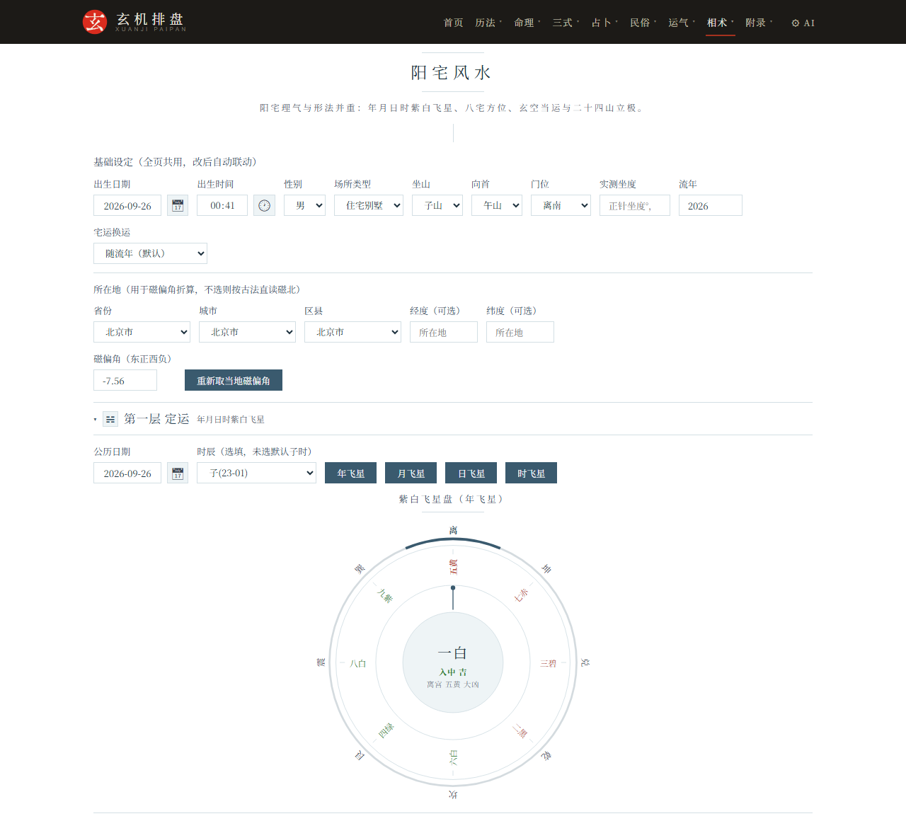
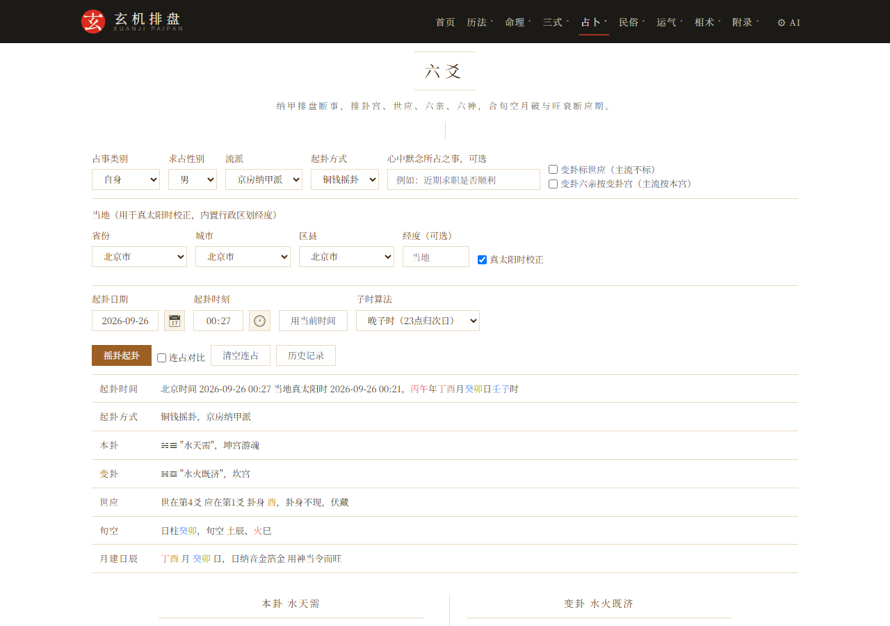
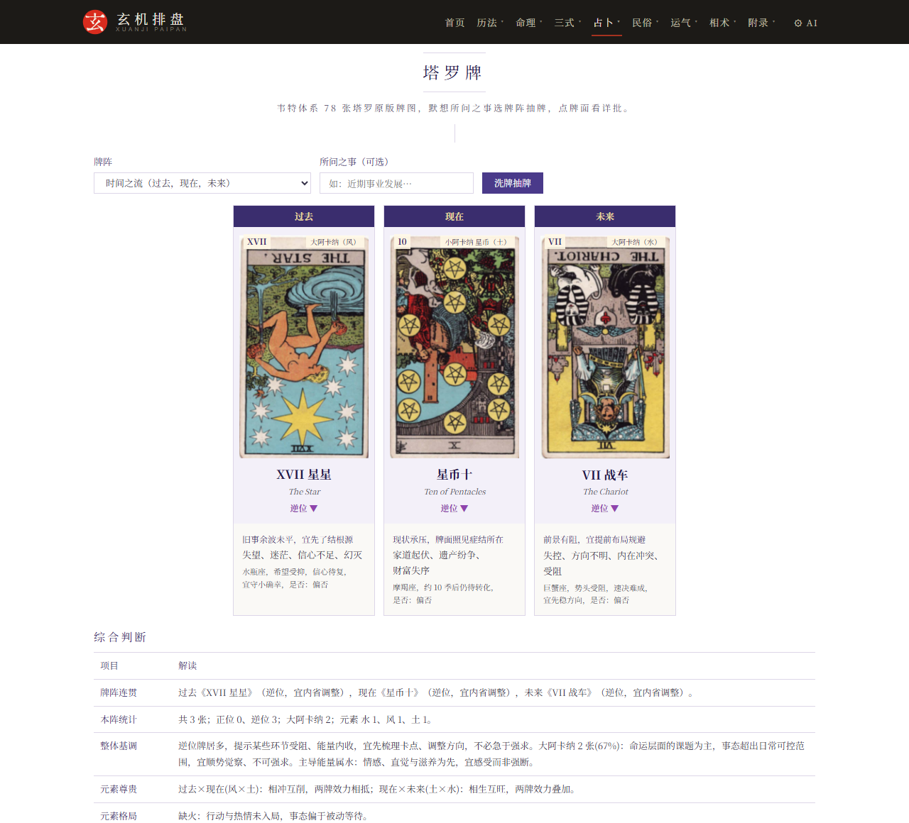

# XuanJi PaiPan

[简体中文](README.md) | [English](README.en.md)

<div align="center">
  

[](https://github.com/GaoRenYouShu/XuanJiPaiPan/deployments)
[](https://xuanjipaipan.vercel.app/)
[](https://xuanjipaipan.pages.dev/)
[](https://xuanjipaipan.netlify.app/)
[](https://gaoren.org/)

[](LICENSE)
[](https://github.com/GaoRenYouShu/XuanJiPaiPan/commits/main)
[](https://github.com/GaoRenYouShu/XuanJiPaiPan)
[](https://github.com/GaoRenYouShu/XuanJiPaiPan)
[](https://github.com/GaoRenYouShu/XuanJiPaiPan/commits/main)
[](#feature-overview)
[](#tech-stack)
[](#tech-stack)
[](#tech-stack)

</div>

A research and demonstration site for traditional Chinese metaphysics, calendrics and divination culture. A pure front-end static application with no backend: open it and it works. The site interface is in Chinese; browser translation works well for a quick look.

**Live demo** (five mirrors serving the same content, pick any):

- gaoren.org (custom domain): https://gaoren.org/
- GitHub Pages: https://gaorenyoushu.github.io/XuanJiPaiPan/
- Vercel: https://xuanjipaipan.vercel.app/
- Cloudflare Pages: https://xuanjipaipan.pages.dev/
- Netlify: https://xuanjipaipan.netlify.app/

All five mirrors serve identical content; speed depends on your location and route. GitHub Pages can be slow on the first load from mainland China (styles and fonts load on demand and settle within seconds); pick whichever is fastest for you.

## Feature Overview

Seven categories with 35 independent tools: Calendars, Fate Analysis, Three Styles, Divination, Folk Practices, Yunqi and Physiognomy.

| Category | Tools |
|---|---|
| **Calendars** | Perpetual Calendar, Almanac, Buddhist Calendar, Taoist Calendar, Tibetan Calendar, Date Selection, Huangji Jingshi |
| **Fate Analysis** | BaZi Chart, BaZi Compatibility, Zi Wei Dou Shu, He Luo Numerology, Tie Ban Shen Shu, Name Analysis, Western Astrology, Qizheng Siyu |
| **Three Styles** | Qi Men Dun Jia, Da Liu Ren, Tai Yi Shen Shu |
| **Divination** | Liu Yao, Plum Blossom Numerology, Xiao Liu Ren, Fortune Sticks, Tarot, Lenormand |
| **Folk Practices** | Folk Divination, Character Divination, Duke of Zhou Dream Interpretation, Twenty-Eight Mansions, Tai Sui and Zodiac |
| **Yunqi** | Five Movements and Six Qi |
| **Physiognomy** | Palmistry, Face Reading, Yang Dwelling Feng Shui, Yin Dwelling Feng Shui, Luopan |

## Interface Preview

| BaZi Chart | Zi Wei Dou Shu |
|:---:|:---:|
|  |  |
| **Western Astrology** | **Yang Dwelling Feng Shui** |
|  |  |
| **Liu Yao** | **Tarot** |
|  |  |

## Main Tools

Introduced in the order of the site's seven sections.

### Calendars (7)

- **Perpetual Calendar**: Gregorian, lunar and sexagenary conversion, the 24 solar terms, holiday markers, and a century-spanning calendar table for quick browsing
- **Almanac**: daily suitability and avoidance, clash and sha, auspicious and inauspicious deities, nayin, jianchu, the 28 mansions, nine-palace flying stars and hourly fortune
- **Buddhist Calendar**: Buddhist year counting against Gregorian and lunar dates, marking Buddha's Birthday, Vesak and other Buddhist festivals
- **Taoist Calendar**: Taoist year counting against Gregorian and lunar dates, marking the Three Primes, Eight Festivals and other Taoist observances
- **Tibetan Calendar**: Kalachakra Phugpa calculations, rabjung year counting, five elements and zodiac, duplicated and omitted days, auspicious days and school differences
- **Date Selection**: almanac-based date selection and destiny-based date selection, two sets of criteria listed side by side
- **Huangji Jingshi**: Shao Yong's yuan, hui, yun and shi framework; four-level placement for any Gregorian year (BC supported), the twelve hui hexagrams and historical anchors

### Fate Analysis (8)

- **BaZi Chart**: four pillars, ten gods, luck cycles, favorable elements, classic ten-god judgments and life-situation readings
- **BaZi Compatibility**: six-dimension scoring and mutual favorability, with two charts compared side by side
- **Zi Wei Dou Shu**: twelve palaces, major and minor stars, four transformations, life and body palaces
- **He Luo Numerology**: BaZi converted to numbers to raise the prenatal hexagram, Yuantang changing lines to derive the postnatal hexagram, yang-nine and yin-six luck cycles, and changing lines for year, month, day and hour layer by layer
- **Tie Ban Shen Shu**: Taixuan number conversion, eight-ke time determination, Huangji totals and verse drawing; birth data can be carried over from the BaZi page
- **Name Analysis**: five-grid profiling, three-talents configuration, three-cycle relations and 81-number numerology, with BaZi favorable-element integration
- **Western Astrology**: natal chart with the Sun through the Ascendant, signs, houses and aspect angles at a glance
- **Qizheng Siyu**: eleven luminaries in their mansions and Dongwei major periods, with true ecliptic longitude computed from the VSOP87 ephemeris

### Three Styles (3)

- **Qi Men Dun Jia**: hour-based nine-palace layout, three marvels and six instruments, eight gates, nine stars and eight deities, with patterns and useful gods annotated automatically
- **Da Liu Ren**: automatic heaven and earth plates, four lessons and three transmissions, the twelve heavenly generals and pattern classifications, with judgments and timing
- **Tai Yi Shen Shu**: Tai Yi accumulated years, the sixteen-deity layout, host and guest counts, and major and minor wanderings

### Divination (6)

- **Liu Yao**: seven casting methods including coins, numbers and time; automatic hexagram construction with six relations, six spirits, world and response lines; void and broken markers and symbolic-star timing; true solar time and consecutive-cast comparison
- **Plum Blossom Numerology**: time-based casting with automatic body and function separation, mutual, changed, opposite and reversed hexagrams, and judgments by generation and restraint and by hexagram qi
- **Xiao Liu Ren**: the six spirit hand formulas of Da An, Liu Lian, Su Xi, Chi Kou, Xiao Ji and Kong Wang; instant judgment from month, day and hour numbers
- **Fortune Sticks**: draw and interpret sticks from the Wong Tai Sin, Guanyin, Yue Lao and Guan Gong sets, with poems, historical allusions and auspicious or inauspicious readings
- **Tarot**: the 78-card Rider-Waite deck, six spreads, upright and reversed keywords with readings by domain, and astrological correspondences
- **Lenormand**: 36 cards, seven spreads, a full 630-pair combination dictionary, playing-card correspondences, significator houses and knight-move reading

### Folk Practices (5)

- **Folk Divination**: bone-weight fortune, offending-month lookup, natal Buddha, phone-number eight-star magnetism and the Book of Three Lives
- **Character Divination**: a curated glyph-splitting dictionary with question-driven splits, six-script annotations, added and removed stroke transformations, component glosses, Kangxi stroke counts, plum-blossom hexagrams, and hour and day correspondences
- **Duke of Zhou Dream Interpretation**: the full 951-entry text in 27 categories from the common edition, with dual-source comparison, keyword search and category browsing
- **Twenty-Eight Mansions**: natal mansion, Yanqin and mansion-based daily suitability, with the twelve palace divisions, the 24-mountain mansion mapping and judgments from the Treatise on the Celestial Offices
- **Tai Sui and Zodiac**: annual Tai Sui offense checks (value, clash, punishment, harm, destruction and combination), yearly and monthly forecasts for the twelve zodiac signs, and biographies of the 60 Tai Sui generals

### Yunqi (1)

- **Five Movements and Six Qi**: annual movement, governing and terrestrial qi, guest and host qi, and qi convergence

### Physiognomy (5)

- **Palmistry**: seven palm shapes with nine palaces and eight mounts, the three major lines and auxiliary lines, a checklist self-assessment, and texts quoted from the Ma Yi Physiognomy
- **Face Reading**: three zones, seven face shapes, the five features, complexion and mole readings with twelve-palace position texts, plus self-assessment and classical illustrations
- **Yang Dwelling Feng Shui**: purple-white flying stars for year, month, day and hour, eight-mansion auspicious directions, 24-mountain orientation and annual Tai Sui avoidance; the compass uses the WMM2025 geomagnetic model to correct declination; the dwelling is the body and the year the function
- **Yin Dwelling Feng Shui**: terrain survey of dragon, sand, water and point, flying-star sitting and facing, three-harmony water methods and the eight-sha, yellow-spring and peach-blossom waters, immortal-destiny mountain matching and 28-mansion metal division, with burial dates chosen to avoid repeated mourning, repeat days, and the four separations and four severances
- **Luopan**: an online geomantic compass that gathers three plates and three needles, metal division, hexagram cycles and the 28 mansions onto one dial, modeled on a real luopan and fully rotatable; the three plate configurations are switchable, north is up and south is down, dial angles are geographic degrees, and black, gold or white backgrounds are available

All divination tools support switching between schools and algorithms, with results computed in real time.

## Site Navigation

The top navigation has eight sections: Calendars, Fate Analysis, Three Styles, Divination, Folk Practices, Yunqi, Physiognomy and the Appendix of three pages.

- **Classics Reference** `dianji.html`: the classics, editions and open access channels behind each module
- **Documentation** `shuoming.html`: casting rules, school choices, source research, conventions and terminology for every tool
- **Algorithms and Data** `opensource.html`: open-source algorithm libraries and data sources, each entry noting its license and the pages it serves

## Tech Stack

- Pure HTML, CSS and vanilla JavaScript with no build step; runs on any static deployment
- Installable to the desktop and home screen (PWA); visited pages work offline; light and dark themes follow the system
- Calendar engine based on [lunar-javascript](https://github.com/6tail/lunar-javascript) (MIT)
- Zi Wei Dou Shu charting based on [iztro](https://github.com/SylarLong/iztro) (MIT)
- Astrology ephemeris based on [astronomy-engine](https://github.com/cosinekitty/astronomy) (MIT)
- Self-hosted fonts (SIL OFL 1.1) that work offline; see `opensource.html` for the full list

## Run Locally

Any static server will do:

```bash
cd XuanJiPaiPan
python -m http.server 8080
# open http://localhost:8080
```

You can also open `index.html` directly; scripts load by relative path and work offline.

## Deploy Online

Pure static with zero build. Fork the repository and pick any host; any domain and subpath work without changing the source: canonical, og:url and share-image links inside pages are generated by `assets/meta.js` from the actual address, and the 404 page is recognized automatically by each platform.

- **GitHub Pages**: repository Settings → Pages → Source: Deploy from a branch, Branch: main and the root directory (`(root)`).
- **Vercel**: import the repository at vercel.com/new, choose Other as the framework preset, leave the build command empty and set the output directory to `./`; keep everything else as default.
- **Cloudflare Pages**: Workers and Pages → Create → Pages → Connect to Git, choose None as the preset, leave the build command empty and set the output directory to `/`.
- **Netlify**: import the repository at app.netlify.com, leave the build command empty and set the publish directory to `./`.
- **Other hosts**: any static host or object storage with a CDN (Alibaba Cloud OSS, Tencent Cloud COS, EdgeOne Pages, Render and others) works by uploading the repository files as they are; no server side needed.

## Repository Stats

| Overview | Languages |
|:---:|:---:|
| [](https://github.com/GaoRenYouShu/XuanJiPaiPan) |  |

### Commit Activity


## Directory Structure

```
XuanJiPaiPan/
├── *.html        40 pages: 35 tools plus the home page, three appendix pages and a 404 page
├── assets/       all scripts, styles, fonts and image sources
├── manifest.webmanifest and sw.js   PWA manifest and offline service worker
├── .nojekyll     skips Jekyll processing on GitHub Pages
├── LICENSE       MIT license text
├── README.md and README.en.md
├── robots.txt
└── sitemap.xml
```

Running the site needs only the root pages and `assets/`; there are no external directory dependencies.

## License

Released under the [MIT License](LICENSE).

- Free to use, including personal use, commercial projects and further development
- Keep the copyright notice and attribution when using or distributing, and link to the repository in a prominent place
- Third-party open-source libraries remain under their respective licenses

## Data Sources and Credits

- [6tail/lunar-javascript](https://github.com/6tail/lunar-javascript): calendar data foundation (MIT)
- [SylarLong/iztro](https://github.com/SylarLong/iztro): Zi Wei Dou Shu engine (MIT)
- [cosinekitty/astronomy-engine](https://github.com/cosinekitty/astronomy): astrology ephemeris (MIT)
- [Wikimedia Commons](https://commons.wikimedia.org/wiki/Category:Rider-Waite_tarot_deck): the 78 public-domain Rider-Waite-Smith tarot cards (drawn by Pamela Colman Smith, 1909)
- [Unicode Unihan Database](https://www.unicode.org/charts/unihan.html): source of Kangxi stroke-count data (Unicode Data Files License)
- CBDB China Biographical Database: person data for the name analysis module (CC BY-NC-SA 4.0)
- Kyoto University Institute for Research in Humanities (Kanripo) and Wikisource: full-text sources of classical works (public domain and CC BY-SA)

See `opensource.html` for the complete list and per-entry licenses.

## Disclaimer

This project is a cultural research and entertainment demonstration. All charting, date selection and divination results are for cultural research reference only; please do not treat them as superstition. For major decisions, rely on professional advice. Chart calculations follow the mainstream conventions of each module, and the interpretation texts are performances of traditional destiny culture.

## Contact

[](https://t.me/gaoren)
